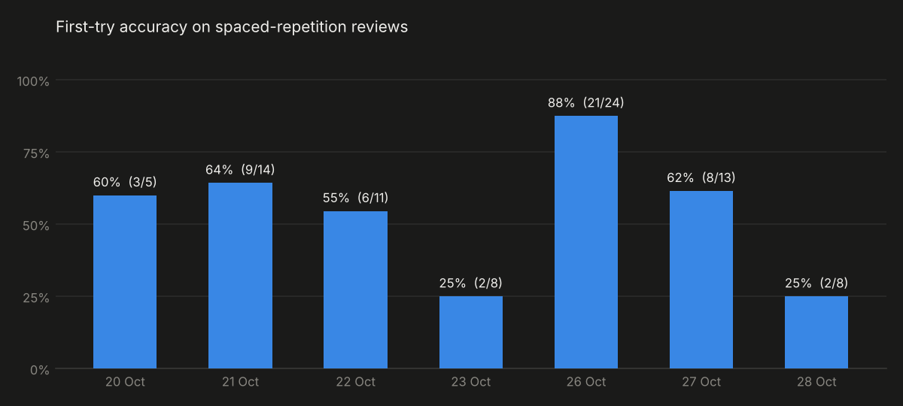

# quant-foundations

Week-by-week curriculum in Python for quantitative finance, from pandas fundamentals to backtesting and machine learning.

## Method

- Each stage has a theory part, coding exercises of increasing difficulty and closed-book drills.
- Exercises are reviewed with spaced repetition. A review counts as correct only on the first attempt, without hints.
- A stage is complete only after a checkpoint test with at least **28/30**. Below that score, the stage is repeated with a new test.
- All exercises run on synthetic OHLCV data (`dati.py`, fixed seed), so every number is reproducible.

## Stages

| Stage | Topic | Status |
|---|---|---|
| 0 | pandas for market data: returns, rolling windows, volatility, Bollinger bands, look-ahead bias, summary statistics | in progress |
| 1 | Functions, type hints, `assert` tests | |
| 2 | Data structures, Big-O, files, error handling | |
| 3 | NumPy and vectorisation | |
| 4 | Modules, classes, Git workflow (`qt/` package) | |
| 5 | Advanced pandas and real market data | |
| 6 | Plotting with matplotlib | |
| 7 | Simulation and statistics in code (Monte Carlo, VaR, beta) | |
| 8 | Vectorised backtesting | |
| 9 | scikit-learn: first model | |
| 10 | Features, classification, data leakage | |
| 11 | PyTorch basics | |
| 12 | Final project | |

## Checkpoint tests

| Date | Stage | Score | Result |
|---|---|---:|---|
| 2026-10-27 | 0 | 19/30 | not passed: retake after review |

## Stage 0 files

Folder: [`w00-pandas-returns-volatility/`](w00-pandas-returns-volatility/)

| File | Content |
|---|---|
| `setup_ok.py` | Environment check |
| `w00_pandas_giro2.py` | Simple and log returns with `shift()` |
| `w00_g2_rolling.py` | Rolling windows: moving averages, rolling volatility |
| `w00_g2_freddo.py`, `w00_g6_freddo.py`, `w00_g7_freddo.py` | Closed-book drills |
| `w00_g3_ripasso.py`, `w00_g4_ripasso.py`, `w00_g5_ripasso.py` | Spaced-repetition drills |
| `w00_g3_statistiche.py` | Summary statistics and annualisation |
| `w00_minitest1.py` | Checkpoint test #1 |
| `dati.py` | Synthetic OHLCV data generator |

Run any file from its folder, e.g. `python w00_g7_freddo.py`.

## Progress

`progress/attempts.csv` holds every review (date, type, first-try result); `progress/make_chart.py` rebuilds the chart.
